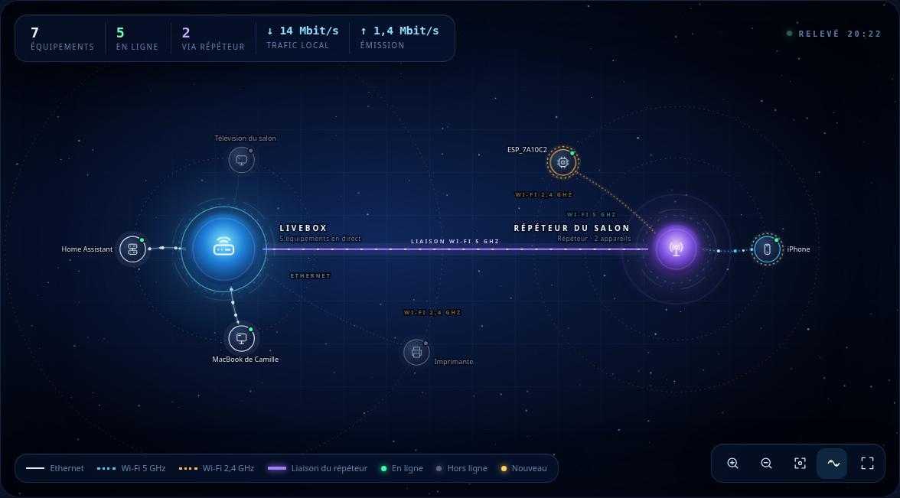
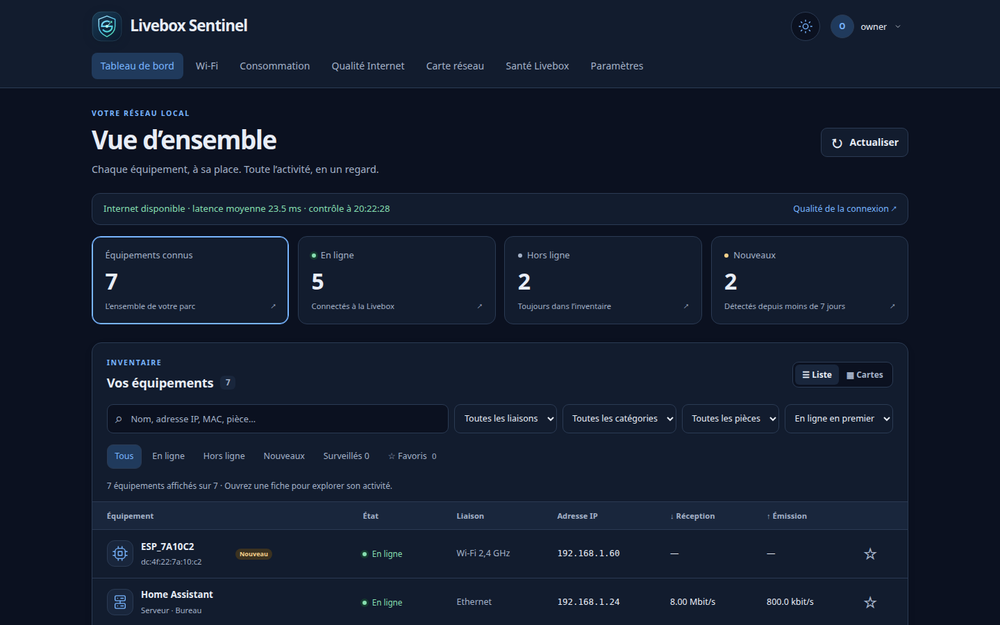
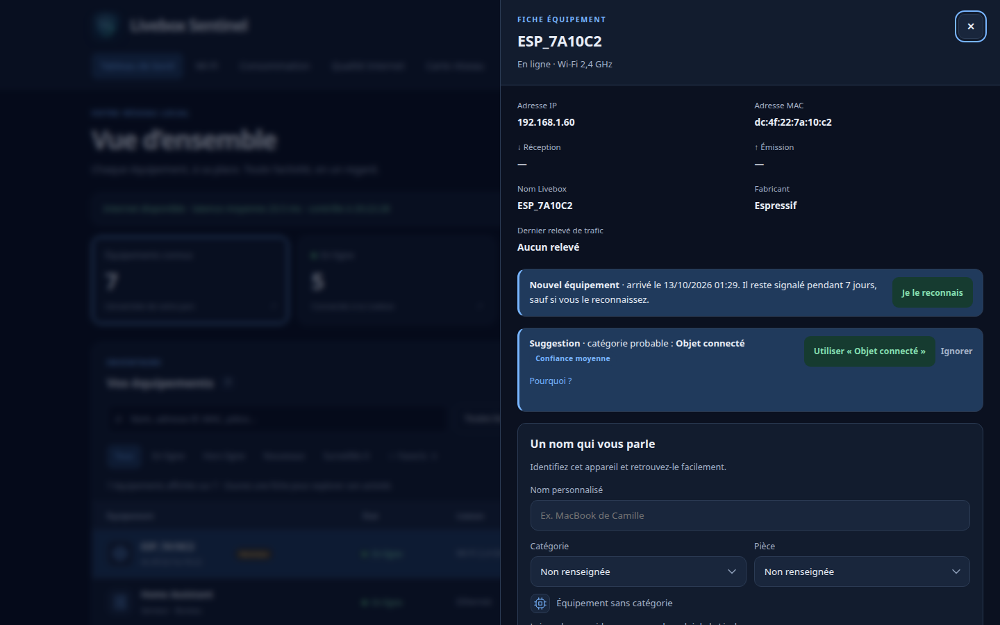
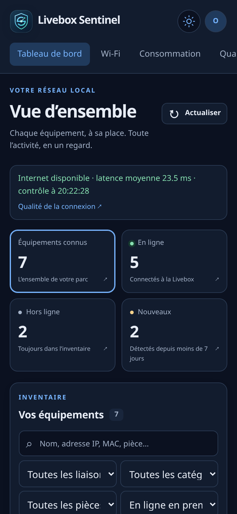

# Livebox Sentinel

**Votre réseau domestique, sous vos yeux.** Livebox Sentinel surveille votre Livebox depuis votre propre serveur : quels appareils sont connectés, par quelle liaison, avec quel débit, et ce qui change au fil du temps. Tout reste chez vous : aucune donnée ne part vers un service externe.



> Projet indépendant, non affilié à Orange. « Livebox » est une marque d’Orange.
>
> Sentinel est né de [LiveboxMonitor](https://github.com/p-dor/LiveboxMonitor), l’application de Pierre Dor pour piloter les Livebox, dont il réutilise les modules pour dialoguer avec la box.

## Ce que fait Sentinel

- **Tableau de bord** : chaque équipement, son état, sa liaison (Ethernet, Wi-Fi 2,4 / 5 GHz), son débit en direct.
- **Carte réseau** : la Livebox au centre, vos répéteurs et vos appareils en orbite selon leur liaison, avec les flux de données animés. Sur téléphone, la même arborescence en liste repliable.
- **Reconnaissance des appareils** : fabricant, modèle annoncé et catégorie suggérée, déduits localement (nom, empreinte DHCP, annonces mDNS/UPnP, registre IEEE).
- **Alertes par e-mail** : nouvel appareil, appareil surveillé absent, coupure Internet.
- **Historique** : connexions et déconnexions, débits de la dernière heure à un an, consommation par appareil, pièce ou catégorie, qualité de la connexion Internet, santé de la Livebox, signal Wi-Fi.
- **Sécurité** : compte protégé, validation en deux étapes (TOTP), sessions révocables, journal des actions, paramètres chiffrés, sauvegardes automatiques de la base.
- **Application installable** sur l’écran d’accueil d’un téléphone ou d’une tablette.

| Tableau de bord | Fiche équipement | Sur mobile |
|---|---|---|
|  |  |  |

*Captures réalisées sur des données fictives.*

## Ce qu’il faut

- Une **Livebox** et son mot de passe d’administration (celui de l’interface `http://192.168.1.1`).
- Un **serveur toujours allumé sur le même réseau** : Raspberry Pi 4 ou 5, NAS, mini-PC… avec **Docker** et **Docker Compose**. Les architectures `amd64` et `arm64` sont prises en charge.

## Installation

```bash
mkdir livebox-sentinel && cd livebox-sentinel
curl -fsSLO https://raw.githubusercontent.com/tomdemat/livebox-sentinel/main/compose.yaml
curl -fsSL -o .env https://raw.githubusercontent.com/tomdemat/livebox-sentinel/main/.env.example
nano .env          # renseignez au moins LIVEBOX_PASSWORD, WEB_PASSWORD (12 caractères minimum) et PUBLIC_URL
mkdir data && sudo chown 1000:1000 data
docker compose pull && docker compose up -d
```

Ouvrez ensuite l’adresse indiquée dans `PUBLIC_URL` (par exemple `http://192.168.1.10:8080`) et connectez-vous avec `WEB_USERNAME` / `WEB_PASSWORD`. Changez ce mot de passe depuis **Mon compte** dès la première connexion.

Depuis une copie du code source, `docker compose up -d --build` construit l’image sur place.

## Configuration

Toutes les variables sont dans `.env` (voir [.env.example](.env.example)).

| Variable | Rôle | Par défaut |
|---|---|---|
| `LIVEBOX_URL` | Adresse de la Livebox | `http://192.168.1.1/` |
| `LIVEBOX_USERNAME` / `LIVEBOX_PASSWORD` | Accès d’administration de la box | `admin` / — |
| `WEB_USERNAME` / `WEB_PASSWORD` | Compte Sentinel créé au premier démarrage | `admin` / — |
| `WEB_PORT` | Port ouvert sur le serveur | `8080` |
| `PUBLIC_URL` | Adresse utilisée dans les liens des e-mails | `http://localhost:8080` |
| `COLLECT_INTERVAL` | Secondes entre deux relevés (minimum 10) | `30` |
| `DATABASE_PATH` | Base SQLite dans le conteneur | `/data/livebox-sentinel.sqlite3` |

Les accès à la Livebox et l’envoi d’e-mails (SMTP) se règlent aussi depuis **Paramètres**, sans redémarrage. Ils y sont chiffrés et priment sur `.env`.

## Au quotidien

**Mettre à jour**
```bash
docker compose pull && docker compose up -d
```

**Sauvegarder** : tout est dans le dossier `data/` (base, clé de chiffrement, sauvegardes automatiques). Copiez-le régulièrement ailleurs. La page **Paramètres › Sauvegardes** permet aussi d’en créer.

**Restaurer** : déposez la sauvegarde dans **Paramètres › Sauvegardes**, qui la vérifie, puis sur le serveur :
```bash
curl -fsSL -o restore.sh https://raw.githubusercontent.com/tomdemat/livebox-sentinel/main/tools/restore.sh   # si vous n’avez pas le code source
docker compose down && sh restore.sh      # ou : sh tools/restore.sh depuis le code source
```
Les sessions ouvertes enregistrées dans la sauvegarde sont effacées : reconnectez-vous ensuite.

**Mot de passe oublié**
```bash
docker compose exec -it livebox-sentinel python tools/account_admin.py reset-password
```

**Accès depuis l’extérieur** : n’exposez pas Sentinel directement sur Internet. Passez par un VPN (WireGuard, Tailscale…) vers votre réseau. Sentinel est servi en HTTP sur votre réseau local ; derrière un proxy HTTPS, indiquez son adresse dans `FORWARDED_ALLOW_IPS` (dans `.env`) pour que les cookies sécurisés et les contrôles d’origine fonctionnent.

## Sécurité

- Compte unique protégé par mot de passe (12 caractères minimum, PBKDF2) et, en option, par un code TOTP ; tentatives limitées.
- Accès à la Livebox et au serveur SMTP chiffrés au repos ; ils ne sont jamais renvoyés par l’interface ni réutilisés vers un autre serveur sans être ressaisis.
- Conteneur sans privilèges, système de fichiers en lecture seule, image construite à partir de versions figées (image de base, LiveboxMonitor, dépendances Python, actions GitHub).
- Une faille ? Merci de la signaler en privé via **Security › Report a vulnerability** sur GitHub plutôt que dans une issue publique.

## Développement

```
livebox-sentinel/
├── sentinel/          l’application (FastAPI) : main.py, features.py, recognition.py, topology.py
│   ├── static/        JavaScript, CSS, icônes
│   └── resources/     registre des fabricants (oui.tsv.gz)
├── tools/             récupération du compte, régénération du registre des fabricants
├── tests/unit/        tests de l’API et de la collecte (base jetable, aucune Livebox réelle)
├── tests/browser/     contrôles d’interface sur un jeu de données fictif
├── compose.yaml · Dockerfile · requirements.txt · .env.example
└── data/              vos données (jamais versionnées)
```

Construire l’image et lancer les tests :

```bash
docker build -t livebox-sentinel:dev .
docker run --rm --network none -v "$PWD":/candidate:ro -w /candidate/tests/unit \
  --entrypoint python livebox-sentinel:dev -m unittest discover -p 'test_*.py'
```

Aperçu de l’interface sur données fictives, sur `http://127.0.0.1:19224` (identifiant `owner`, mot de passe `preview-only-password`) :

```bash
docker run --rm -p 127.0.0.1:19224:19224 -v "$PWD":/candidate:ro --tmpfs /tmp \
  --entrypoint python livebox-sentinel:dev /candidate/tests/browser/fixture_preview.py
```

## Soutenir le projet

Livebox Sentinel est libre et gratuit, développé et maintenu sur mon temps libre. Si l’outil vous rend service, vous pouvez soutenir son développement par un don, ponctuel ou régulier :

<a href="https://liberapay.com/tomdemat/donate"></a>

Signaler un problème, proposer une idée ou partager le projet aide tout autant.

## Crédits

- **[LiveboxMonitor](https://github.com/p-dor/LiveboxMonitor) de Pierre Dor** (licence MIT) : l’inspiration de ce projet. Sentinel s’appuie sur ses modules Python pour dialoguer avec la Livebox ; son travail d’exploration de l’API de la box rend tout le reste possible. Merci à lui et à ses contributeurs.
- Registre des fabricants : IEEE, via le fichier `manuf` de [Wireshark](https://www.wireshark.org/).

## Licence

[MIT](LICENSE).
